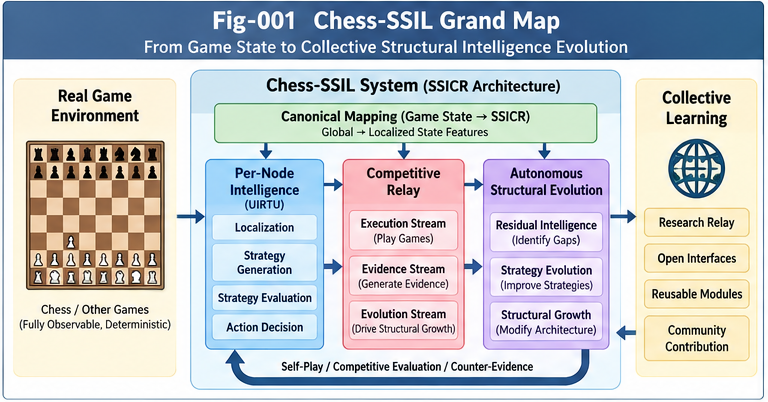

# Chess as a Strategic Structural Intelligence Laboratory (Chess-SSIL)

**From Competitive UIRTU-Relay to Autonomous Strategy Evolution and Collective Learning**

**Authors:** Sizhe Tan & GPT-Obot  
**Version:** v1.0.0 (research proposal)  
**Status:** Open research framework; hypotheses and provisional contracts, not a validated autonomous structural-intelligence implementation.

## Overview

Chess-SSIL uses chess and smaller deterministic games as a controlled laboratory for studying **Strategic Structural Intelligence and Competitive UIRTU-Relay (SSICR)**. Its purpose is not to build another chess engine. It is to turn structural-intelligence concepts into **separable, testable, reproducible research questions** and make the resulting evidence and components portable across independent researchers.

The proposed progression is:

**SIF functional architecture → UIERU / UIRTU-Relay → SSICR strategy generation and competition → game-based experiments → collective structural learning.**

The repository is a companion to the foundational SSICR research, not a replacement or duplication of that theory.

---



---

## Core research proposition

A game supplies authoritative rules, states, legal actions, transitions, and outcome signals. A strategic agent must still **localize** the game state into meaningful perspectives, evaluate candidates, allocate search, and select actions. Competitive play then yields three distinguishable streams:

1. **Execution:** decisions and verified state transitions.
2. **Evidence:** predictions, outcomes, uncertainty, failures, and counter-evidence.
3. **Evolution:** parameter learning, strategy revision, or independently validated structural changes.

The streams do not automatically imply structural growth. Evidence attribution, change proposals, fair comparisons, acceptance gates, and rollback must be implemented and tested.

## Six research insights

### 1. Separate game state, localization, and strategy

The board is a canonical state representation, not itself a complete strategic interpretation. Multi-perspective localization (tactics, position, endgame, opponent behavior) should be separately inspectable from per-node evaluation and strategy generation.

### 2. Distinguish strategy learning from structural evolution

Self-play can improve strategy without changing an agent's architecture. A claim of **structural evolution** must identify what changed (for example, a localization operator, scoring module, UIRTU, or strategy-generator composition) and show benefit against compute- and data-matched baselines.

### 3. Use residuals as research inputs

Unfamiliar states, systematic prediction errors, evaluator disagreements, integration failures, and transfer failures can trigger targeted diagnosis. A residual becomes a reusable contribution only after a proposed remedy survives independent validation.

### 4. Partition problems by strategy generability

**Strategy-Generability Partition (SGP)** distinguishes tasks with sufficiently specified rules, actions, evaluators, feedback, and safety boundaries from tasks requiring residual handling. Candidate maturity levels are **G1 Searchable**, **G2 Learnable**, and **G3 Structurally Evolvable**. This is a *proposed assessment framework*, not an assertion that most real-world problems are already automatically solvable.

### 5. Convert residuals into validated generable subproblems

**Residual-to-Generable Conversion (RGC)** investigates decomposition, new localization, evidence acquisition, evaluator construction, and safe simulation. A conversion requires independent checks that the surrogate objective and test environment adequately represent the original task.

### 6. Improve research relay, not only individual algorithms

Collective learning requires more than publication: contributions should carry applicable contexts, interface versions, baselines, costs, negative results, and reproduction instructions. Small, portable research units can be more useful than incompatible end-to-end systems.

## Research boundaries

- Chess and Go are not interchangeable: both are useful games, but their rules, state spaces, and available methods differ.
- AlphaGo/AlphaZero provide evidence for powerful autonomous **strategy learning** in specified games; they do not establish solved Go, unrestricted structural self-improvement, or general ASI.
- Automated strategy **generation** does not grant authority to execute consequential actions. Subject boundaries, evaluation sovereignty, and governance remain separate requirements.
- Claims of improvement must account for search budget, training data, hardware, random seeds, test leakage, and uncertainty.

## Suggested starting path

**For newcomers:** Read [START-HERE.md](START-HERE.md), then [CSSIL-001](docs/CSSIL-001-Chess-as-a-Canonical-SSICR-Laboratory.md) and [CSSIL-006](docs/CSSIL-006-Strategy-Generability%20Partition%20and%20Residual-to-Generable%20Evolution.md).

**For implementers:** Begin with the three provisional contracts under [`specs/`](specs/), then select a small-game experiment from [`research/VALIDATION-ROADMAP.md`](research/VALIDATION-ROADMAP.md).

**For critical reviewers:** Consult [`research/OPEN-QUESTIONS.md`](research/OPEN-QUESTIONS.md) and [`research/TESTABLE-HYPOTHESES.md`](research/TESTABLE-HYPOTHESES.md). Counterexamples and null results are welcome.

## Repository map

```text
Chess-Strategic-Structural-Intelligence-Laboratory/
├── README.md
├── START-HERE.md
├── CONTENTS.md
├── docs/
│   ├── CSSIL-001-Chess-as-a-Canonical-SSICR-Laboratory.md
│   ├── CSSIL-002-Localization-Per-Node-and-Strategy-Generation.md
│   ├── CSSIL-003-Competitive-Relay-and-Autonomous-Strategy-Evolution.md
│   ├── CSSIL-004-Residual-Intelligence-and-Structural-Growth.md
│   ├── CSSIL-005-Collective-Learning-and-Research-Relay.md
│   └── CSSIL-006-Strategy-Generability Partition and Residual-to-Generable Evolution.md
├── specs/
│   ├── SPEC-001-Game-State-Localization-and-UIRTU-Contract.md
│   ├── SPEC-002-Strategy-Evaluation-and-Competitive-Relay.md
│   └── SPEC-003-Structural-Growth-and-Evidence-Record.md
├── research/
│   ├── OPEN-QUESTIONS.md
│   ├── TESTABLE-HYPOTHESES.md
│   └── VALIDATION-ROADMAP.md
├── figures/
│   ├── Fig-001-Chess-SSIL-Grand-Map.png
│   ├── Fig-002-Chess-Localization-and-Per-Node-Intelligence.png
│   ├── Fig-003-Competitive-Strategy-Evolution-Loop.png
│   ├── Fig-004-Autonomous-Structural-Growth-Ladder.png
│   └── Fig-005-Collective-Learning-and-Research-Relay.png
├── GLOSSARY.md
├── FIGURE-INDEX.md
├── FUTURE-DIRECTIONS.md
├── CHANGELOG.md
├── CITATION.cff
├── .zenodo.json
├── GitHub-Release-Notes-v1.0.0.md
├── ResearchGate-Description.txt
└── Chess-SSIL-v1.0.0-ResearchGate-Overview.pdf
```

This tree is the **planned v1.0.0 layout**; some companion/navigation/release files may still be in preparation. See [CONTENTS.md](CONTENTS.md) once available for the final release inventory.

## Core papers

| Paper | Research focus |
| --- | --- |
| [CSSIL-001](docs/CSSIL-001-Chess-as-a-Canonical-SSICR-Laboratory.md) | Chess as a canonical, falsifiable SSICR laboratory |
| [CSSIL-002](docs/CSSIL-002-Localization-Per-Node-and-Strategy-Generation.md) | Localization, per-node intelligence, strategy generation |
| [CSSIL-003](docs/CSSIL-003-Competitive-Relay-and-Autonomous-Strategy-Evolution.md) | Competitive execution, evidence, learning, and evolution |
| [CSSIL-004](docs/CSSIL-004-Residual-Intelligence-and-Structural-Growth.md) | Residual triggers, counter-evidence, structural change |
| [CSSIL-005](docs/CSSIL-005-Collective-Learning-and-Research-Relay.md) | Portable contributions and collective research relay |
| [CSSIL-006](docs/CSSIL-006-Strategy-Generability%20Partition%20and%20Residual-to-Generable%20Evolution.md) | SGP, RGC, and expanding autonomous strategy coverage |

## Provisional interface contracts

- [SPEC-001 — Game State, Localization, and UIRTU](specs/SPEC-001-Game-State-Localization-and-UIRTU-Contract.md)
- [SPEC-002 — Strategy Evaluation and Competitive Relay](specs/SPEC-002-Strategy-Evaluation-and-Competitive-Relay.md)
- [SPEC-003 — Structural Growth and Evidence Record](specs/SPEC-003-Structural-Growth-and-Evidence-Record.md)

These are **research proposals**, not standards or claims of production interoperability.

## Experimental sequence

| Phase | Focus | Minimum evidence |
| --- | --- | --- |
| 0 | Contract and reproducibility checks | Versioned state, legal moves, replayable traces |
| 1 | Canonical SSICR mapping | Separable localization, decisions, and transitions |
| 2 | Localization and strategy generation | Controlled baseline comparisons |
| 3 | Competitive relay and residual handling | Recorded predictions, failures, and interventions |
| 4 | Autonomous structural strategy evolution | Identifiable changes with matched-budget gains and rollback |
| 5 | Collective learning and research relay | Independent reproduction and cross-implementation reuse |

See [VALIDATION-ROADMAP.md](research/VALIDATION-ROADMAP.md) for gates, evidence levels, and evaluation design.

## Six hints for collective learning contributors

1. **Start small:** Tic-Tac-Toe, Nim, and Connect Four are often better first experiments than full Chess or Go.
2. **Expose boundaries:** keep authoritative state, localization, scoring, and action selection distinct.
3. **Compare fairly:** report compute, data, seeds, baselines, and uncertainty; distinguish architecture changes from additional search.
4. **Publish counter-evidence:** failures and non-improvements help the next researcher avoid repeating dead ends.
5. **Contribute portable pieces:** one well-specified localization operator or residual trigger is a legitimate research contribution.
6. **Measure relay success:** assess whether others can identify when a result applies, reproduce it, and integrate it without rewriting the entire system.

### Minimal contribution record

A useful contribution should specify:

```yaml
contribution_id: example-001
research_question: "Which hypothesis or residual does this address?"
game_and_rules_version: "Specify the environment"
component_type: "localization | scoring | strategy | evaluator | residual | relay"
contract_version: "Specify applicable SPEC revision"
applicability_and_limitations: "When should it be used?"
baseline_and_budget: "Data, compute, search, hardware, seeds"
method_and_reproduction: "Steps and dependencies"
results_and_uncertainty: "Metrics, intervals, negative results"
counter_evidence: "Failures and known exceptions"
provenance_and_license: "Authors, version, usage terms"
```

This record is illustrative; the three SPEC files define the proposed detailed contracts.

## Figures


The five planned figures cover the grand map, localization/per-node intelligence, competitive strategy evolution, autonomous structural growth, and collective research relay. Consult [FIGURE-INDEX.md](FIGURE-INDEX.md) when the figure package is finalized.

## Scope, citation, and reuse

Chess-SSIL is a **research proposal and experimental guide**. It does not claim that its hypotheses have been empirically established. Contributions should preserve provenance, experimental limitations, and counter-evidence.

For bibliographic metadata, use [`CITATION.cff`](CITATION.cff) after it is finalized. Add the **actual Zenodo DOI** only after a DOI has been assigned; do not substitute a placeholder DOI in public citations. Licensing terms should be specified in the released repository before reuse assumptions are made.

## Closing perspective

> **Do not demand that autonomy solve everything first. Build a verified generable core, preserve the residual frontier, and expand through evidence-backed structural relay.**

The goal is not merely to teach an AI to win games. It is to make strategy-generation mechanisms **observable, testable, improvable, and collectively reusable**—and to discover where the analogy to open-world intelligence succeeds or fails.
