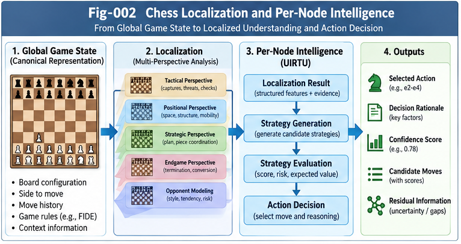

# CSSIL-002 — Localization, Per-Node Intelligence, and Strategy Generation

**Repository:** Chess as a Strategic Structural Intelligence Laboratory (Chess-SSIL)  
**Version:** 1.0.0  
**Authors:** Sizhe Tan & GPT-Obot  
**Status:** Research framework and testable architectural proposal  
**Companion:** CSSIL-001 — Chess as a Canonical SSICR Laboratory

## Abstract

A chessboard is an observable game state, not yet an operational strategic interpretation. This paper proposes a modular account of chess intelligence that separates state representation, structural localization, per-node intelligence, and strategy generation. It uses chess as a controlled laboratory for Strategic Structural Intelligence and Competitive UIRTU-Relay (SSICR), while treating the proposed architecture as a research hypothesis rather than an assertion about how existing chess engines are implemented. The central engineering question is whether explicit, portable, perspective-aware structures can improve interpretability, transfer, adaptive computation, or structural evolution relative to strong fixed-architecture baselines.

---



---

## 1. Scope and Research Position

This document focuses on the decision-making path *within* a turn. CSSIL-003 examines competition and self-play across turns; CSSIL-004 examines residual evidence and structural growth; CSSIL-005 examines collective research relay. The present proposal does not claim that an explicit structural localization layer is necessary for strong chess play. End-to-end systems and classical search engines are essential comparison points.

A useful distinction is:

1. **State representation:** What is legally present on the board, including turn, castling rights, en-passant status, and relevant history.
2. **Localization:** Which strategic situations, constraints, patterns, and unresolved features are active in this state.
3. **Per-node intelligence:** What candidate actions, local evaluations, and supporting evidence are produced by specialized modules.
4. **Strategy generation:** How the system composes perspectives, allocates computation, evaluates continuations, and selects an action.

The four layers can be implemented separately, jointly, or as virtual interfaces around an integrated model. Their separation is an experimental design choice, not an empirical conclusion.

## 2. From Board State to Logical Localization

Let a legal game state be

\[
s_t=(B_t,\tau_t,c_t,e_t,h_t),
\]

where \(B_t\) is piece placement, \(\tau_t\) the side to move, \(c_t\) castling rights, \(e_t\) en-passant availability, and \(h_t\) the history relevant to repetition and other rules. A board diagram alone may not identify the full legal state.

A localization operator maps the state and an optional perspective to an actionable description:

\[
z_t^{(p)}=L_p(s_t,\mathcal H_t;\theta_p).
\]

Possible perspectives include king safety, tactical forcing lines, material balance, pawn structure, mobility, initiative, endgame conversion, and opponent-specific tendencies. Each perspective should expose its evidence, applicability conditions, uncertainty, and known blind spots rather than only an opaque scalar score.

**Illustrative example.** A position with an exposed king and a material advantage may be localized simultaneously as *materially favorable*, *tactically unstable*, and *requiring forcing-line search*. These labels are hypotheses to be checked against concrete legal moves and continuations; they are not substitutes for calculation.

### 2.1 Structural localization as a differential tree

A candidate differential-tree representation may distinguish:

- **Root:** Current legal state and active decision objective.
- **Branches:** Strategic perspectives and salient state differences.
- **Nodes:** Local features, constraints, candidate motifs, and relevant precedents.
- **Edges:** Applicability, dependency, conflict, and evidence relations.
- **Residual nodes:** Features not adequately explained by available branches.

The tree is a useful *view*, not necessarily the sole data structure: chess dependencies can be graph-like, and transpositions create shared states. An implementation should permit a DAG or graph when needed.

### 2.2 Localization quality

Evaluate localization by more than agreement with expert annotations. Useful tests include predictive calibration, legal-move coverage, stability under equivalent representations, out-of-distribution recognition, computation cost, and whether downstream decisions improve when the localization output is available.

## 3. Per-Node Intelligence as Portable Decision Services

A per-node module is a bounded service that consumes a localized context and returns evidence or candidate actions. Modules may implement explicit rules, tactical search, learned evaluation, tablebase queries, or probabilistic forecasts.

A minimal proposed interface is:

```text
PerNodeRequest:
  game_state_id
  ruleset_version
  perspective_id
  localized_features
  candidate_actions
  compute_budget

PerNodeResponse:
  proposed_actions
  scores_and_score_semantics
  evidence_and_provenance
  uncertainty_or_calibration
  applicability_conditions
  compute_used
  residual_flags
```

The score semantics matter: win/draw/loss probability, centipawn evaluation, heuristic rank, and expected tournament points are not interchangeable without an explicit transformation. All returned actions must be checked against the legal-action generator.

### 3.1 From rules to richer decision structures

A beginner may use rules such as “develop pieces” or “protect the king.” A stronger system may combine conditional patterns, search, evaluation functions, and learned priors. The proposed SSICR architecture permits a rule to retain links to its supporting evidence, exceptions, transition models, and uncertainty instead of treating the rule as an irreversible compression.

This is a **fold/unfold hypothesis**: retain enough provenance to reopen a compressed decision when the situation demands it. It does not imply that every compressed rule can be perfectly inverted.

### 3.2 Candidate action generation

For a legal-action set \(A(s_t)\), a module may propose a subset \(C_p(s_t)\subseteq A(s_t)\), together with a rationale and confidence. A separate coverage mechanism can ensure that pruning does not silently eliminate critical defensive moves. The full legal set remains the ground truth for validity.

## 4. Strategy Generation Above Per-Node Intelligence

A Strategy Generator is not merely an action-scoring function. It chooses which perspectives and modules to consult, how much search to perform, how to reconcile conflicting assessments, and when to request additional evidence.

A candidate formulation is:

\[
(\mathcal P_t,\mathcal M_t,b_t)=G(s_t,\mathcal H_t,\mathcal R_t,B_t),
\]

where \(\mathcal P_t\) selects perspectives, \(\mathcal M_t\) selects modules, \(b_t\) allocates a computation budget, \(\mathcal R_t\) contains residual and reliability signals, and \(B_t\) is the total budget. The action policy then selects

\[
a_t=\Pi\bigl(s_t,\{L_p\}_{p\in\mathcal P_t},\{M_j\}_{j\in\mathcal M_t},b_t\bigr),\qquad a_t\in A(s_t).
\]

This division allows **three distinct learning targets**:

1. **Action improvement:** Better moves under an otherwise fixed policy.
2. **Strategy improvement:** Better selection and composition of existing modules.
3. **Generator improvement:** Better rules for constructing and evaluating strategies, including candidate changes to the module library itself.

Only the third directly approaches the proposed autonomous *structural* evolution agenda. Parameter learning inside a fixed network does not, by itself, demonstrate structural growth.

## 5. Multi-Perspective Scoring and Conflict Resolution

A scoring forest may contain several independently maintained evaluators. Their outputs must not be naively summed if they differ in scale, calibration, horizon, or assumptions. A control plane can require:

- declared score units and optimization objectives;
- explicit weighting or learned aggregation with validation;
- evidence and counter-evidence links;
- conflict detection and escalation to deeper search;
- versioned changes and rollback of evaluators.

For example, material advantage may favor one move while king-safety analysis rejects it. The conflict should trigger a tactical verification or budget reallocation, not arbitrary score averaging.

**Opponent awareness:** The best move depends on the assumed opponent policy in some practical settings, but game-theoretic robustness should be evaluated separately from exploiting a particular opponent. A policy that wins against one weak opponent may perform poorly against diverse or adversarial opponents.

## 6. Residual Localization and Unknown Situations

A residual is a mismatch between the available structural explanations and the evidence required for a reliable decision. Examples include unfamiliar tactical motifs, contradictory evaluator outputs, poor calibration, unexpected search outcomes, or a position that falls outside a module's declared applicability region.

A residual trigger might be defined as

\[
T_t=\mathbf 1\{D_t>\delta_D\;\lor\;U_t>\delta_U\;\lor\;C_t>\delta_C\},
\]

where \(D_t\) is predictive discrepancy, \(U_t\) uncertainty, and \(C_t\) evaluator conflict. Thresholds should be calibrated on held-out data. Triggering can dispatch deeper search, alternate localization, a specialized module, or a sandboxed candidate-structure experiment.

Crucially, an unfamiliar position is not proof that a new structural component is needed. Strong baselines may resolve it through more search or better parameter training. The research task is to identify cases where a new portable structure adds measurable value.

## 7. UIRTU-Relay Interpretation

A chess move is an **action instance**; it is not automatically an entire UIRTU. In the proposed mapping, a UIRTU is a reusable intelligence unit with an invocation contract, decision function, output semantics, and optional evidence record. A turn may invoke multiple UIRTUs; the chosen action changes the shared state and thereby triggers the opponent's next decision cycle.

A canonical turn is:

```text
Legal State
  -> Perspective Localization
  -> Per-Node Module Dispatch
  -> Candidate Strategy Construction
  -> Search / Evaluation / Conflict Resolution
  -> Legal Action Selection
  -> State Transition and Evidence Record
  -> Opponent Turn (Competitive Relay)
```

The competition is a natural source of adversarial evidence. It does not automatically supply learning: a learning procedure, attribution mechanism, and structural update policy must be specified separately.

## 8. Minimal Experimental Program

**Experiment A — Layer separation.** On Tic-Tac-Toe or Nim, implement the four conceptual layers and compare against an optimal solver. Verify legality, state reconstruction, and decision traceability.

**Experiment B — Localization value.** On Connect Four or selected chess positions, compare a fixed search baseline with and without explicit localization features under matched compute and data budgets. Report win rate, tactical accuracy, calibration, latency, and ablations.

**Experiment C — Modular strategy generation.** Permit a controller to choose between tactical search, heuristic evaluation, and alternative perspectives. Compare against fixed schedules and equally budgeted learned controllers.

**Experiment D — Residual-triggered dispatch.** Inject unfamiliar or adversarial positions. Measure whether uncertainty/conflict triggers improve performance net of extra computation and false alarms.

**Experiment E — Structural change.** Allow candidate modules to be proposed, validated on separate position sets, and admitted or rejected through a versioned registry. Test whether improvements survive new opponents and out-of-distribution positions.

For all experiments, publish seeds, game rules, position sets, evaluation protocols, compute accounting, and negative results. Separate development, validation, and held-out evaluation to avoid Goodhart effects and benchmark overfitting.

## 9. Research Hints for Collective Learning

**Hint 1 — Do not conflate state and localization.** A correct FEN or board array is not yet an explanation of what matters strategically.

**Hint 2 — Make score meanings explicit.** Module scores must carry units, horizons, calibration, and applicability limits.

**Hint 3 — Keep legal actions authoritative.** Learned or symbolic modules may suggest moves, but rules determine legality.

**Hint 4 — Test interfaces, not just chess strength.** A reusable module is valuable only if others can invoke, interpret, and validate it.

**Hint 5 — Preserve counter-evidence.** Store failed predictions, evaluator disagreements, and rejected structural candidates with provenance.

**Hint 6 — Compare with strong alternatives.** Explicit structures should earn their complexity through demonstrated gains in accuracy, efficiency, transfer, interpretability, or adaptability.

Independent contributors can focus on one localization perspective, one per-node module, one residual trigger, or one reproducible benchmark. Complete SSICR implementations are not prerequisites for useful contributions.

## 10. Open Questions

1. Which localization structures improve downstream decisions after controlling for search budget?
2. Can explicit multi-perspective modules generalize better than a monolithic evaluator under distribution shift?
3. When does preserving unfolded evidence outperform compact rules or learned embeddings?
4. How should a Strategy Generator trade decision quality against computation and latency?
5. Can residual triggers distinguish genuine missing structure from insufficient search?
6. What evidence suffices to accept a new UIRTU or retire an old one?
7. Which contracts permit independently developed modules to compose without hidden semantic incompatibilities?

## 11. Relation to the Chess-SSIL Series

- **CSSIL-001:** Canonical mapping of chess to SSICR and the experimental research bridge.
- **CSSIL-002 (this paper):** Localization, per-node decision services, and Strategy Generator interfaces.
- **CSSIL-003:** Competitive Relay, self-play, and autonomous strategy evolution.
- **CSSIL-004:** Residual intelligence, counter-evidence, and structural growth.
- **CSSIL-005:** Collective learning, research relay, and portable contributions.

The companion `SPEC-001`, `SPEC-002`, and `SPEC-003` documents are proposed research contracts, not established standards.

## 12. Conclusion

Chess offers a controlled way to examine the transition from observable states to logical localization, from localized evidence to per-node intelligence, and from per-node services to generated strategies. The main claim is not that structural decomposition is inherently superior, but that its interfaces and evolution mechanisms can be stated precisely enough to test. If successful, the approach could help turn competitive play into a reproducible laboratory for portable, composable, and eventually self-improving structural intelligence. If unsuccessful, careful counter-evidence will still clarify which structural abstractions are unnecessary or too costly.

---

**Suggested citation:** Tan, S., & GPT-Obot. (2026). *CSSIL-002: Localization, Per-Node Intelligence, and Strategy Generation*. Chess as a Strategic Structural Intelligence Laboratory, v1.0.0. DOI to be assigned upon repository release.

**Keywords:** Chess; Strategic Structural Intelligence; SSICR; UIRTU-Relay; Localization; Per-Node Intelligence; Strategy Generator; Scoring Forest; Residual Intelligence; Collective Learning.
